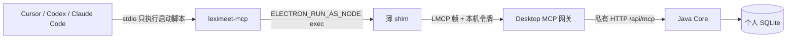

# AI 助手连接

1.0.1 起，词遇桌面可以把本机词典、单词本和学习进度提供给 **Cursor、Codex、Claude Code**。功能名叫「AI 助手连接」，使用官方 [Model Context Protocol](https://modelcontextprotocol.io/)，和浏览器插件用的 **LMCP** 不是同一套协议。

当前只支持 **macOS arm64**。Windows / Linux 以及 Windsurf、Claude Desktop、VS Code 不在本版范围。

## 和 LMCP 的区别

|          | AI 助手连接（MCP）                                  | 插件连接（LMCP 1.0.0）                |
| -------- | --------------------------------------------------- | ------------------------------------- |
| 给谁用   | Cursor / Codex / Claude Code                        | 浏览器插件                            |
| 传输     | 客户端 stdio → 启动脚本 → 薄 shim → 本机 UDS → Core | Native Messaging → UDS → Core         |
| 默认能力 | 只读查询                                            | 查词与采集（经配对授权）              |
| 写入     | 仅「加入单词本」，默认关，需设置授权                | `recordEncounter`（用户在网页确认后） |
| 复习判题 | 不允许                                              | 不在 LMCP 提供                        |

两者复用同一套本机帧、私有文件和 Core 资料，但不共享配对票据或 Core HTTP 令牌。

## 使用

1. 打开词遇，进入 **设置 → AI 助手连接**。
2. 确认本机服务就绪。
3. 对已安装的 Cursor、Codex 或 Claude Code 点 **一键接入**。
4. 如需让助手把单词加入单词本，打开 **允许助手把单词加入单词本**；可随时撤销。
5. 用 **测试连接** 做 `initialize` + `tools/list`。
6. **断开** 只删除词遇写入的配置键，并撤掉写入授权意图；其他人的 MCP 配置保留。

桌面没运行时，`initialize` / `ping` / `tools/list` 仍可完成握手；真正的工具调用会收到 `DESKTOP_NOT_RUNNING`，**不会**自动打开词遇。

## 一键接入如何写配置

优先级：官方 CLI / deeplink → 安全写配置 → 复制命令。写入前先备份为 `.leximeet.bak.<时间>`，只保留最近 3 份；解析失败则不写；只改 `leximeet` 一个键；尽量保留注释和格式；发现文件在写入前被改过就重试或放弃；临时文件带随机后缀再原子改名；重复接入保持幂等。

三家客户端都只配置 **一条稳定启动脚本** 的绝对路径（macOS 为 `~/Library/Application Support/LexiMeet/mcp/leximeet-mcp`）。脚本内容仿 Native Host：`export ELECTRON_RUN_AS_NODE=1` 后 `exec` 随包 Electron 与 shim。`--run-as-node` 不是有效参数，不会写入配置。应用升级或移动后会重写脚本，用户配置不用改。

| 客户端      | 官方方式                                                                                                          | 配置位置                                           | 本机写入                                                        |
| ----------- | ----------------------------------------------------------------------------------------------------------------- | -------------------------------------------------- | --------------------------------------------------------------- |
| Cursor      | `cursor://anysphere.cursor-deeplink/mcp/install?name=leximeet&config=<encodeURIComponent(base64)>`，或 `mcp.json` | `~/.cursor/mcp.json` 的 `mcpServers`               | `{ command: 启动脚本, args: [] }`，无 env、无密钥               |
| Codex       | `codex mcp add leximeet -- <启动脚本>`                                                                            | `~/.codex/config.toml` 的 `[mcp_servers.leximeet]` | 含 `default_tools_approval_mode = "writes"`；CLI 接入后也会补上 |
| Claude Code | `claude mcp add --scope user --transport stdio leximeet -- <启动脚本>`                                            | `~/.claude.json` 顶层 `mcpServers`                 | `{ type: "stdio", command: 启动脚本, args: [] }`                |

客户端配置里 **不放** Core 令牌、端口、SQLite 路径或 Electron 本体。Cursor 安装链接按[官方文档](https://cursor.com/docs/mcp/install-links)把 JSON 先做 base64，再对 `name` 与 `config` 做 `encodeURIComponent`。复制命令对 Cursor 给出完整 deeplink。

对照来源：[Cursor MCP](https://cursor.com/docs/mcp)、[Cursor 安装链接](https://cursor.com/docs/mcp/install-links)、[Codex MCP](https://developers.openai.com/codex/mcp)、[Claude Code MCP](https://code.claude.com/docs/en/mcp)。

## 路由式工具

为节省上下文，只暴露四件工具：

1. `leximeet_help`：列出词典 / 单词本 / 复习查询 / 统计。
2. `leximeet_describe(group)`：按组返回 action 与参数。
3. `leximeet_query(action, args)`：只读统一入口。
4. `leximeet_write(action, args)`：目前只有 `add_to_vocab`，`readOnlyHint=false`。

查询 action：`lookup_word`、`search_words`、`get_examples`、`get_word_status`、`list_due_reviews`、`get_learning_stats`、`list_notebooks`、`list_encounters`。

默认返回精简字段；`detail=true` 才给完整词卡。列表分页，结果有大小上限；超长列表会缩小本页并给出 `nextCursor`。没有 `record_review`，助手不能提交复习结果或污染 FSRS。未知工具返回 JSON-RPC `-32602`。

协议优先协商 `2025-06-18`；旧客户端仍可声明 `2025-03-26` / `2024-11-05`。`title`、`annotations`、`structuredContent` 按协商版本出现。

## 架构

- Electron 只做转发和配置写入；工具定义、路由、权限和参数校验在 Core。
- 启动脚本用随包 Electron 的 Node 模式，不要求用户安装 JDK，也不会拉起词遇窗口。
- shim 每次请求重新解析指针/描述符，桌面稍后打开时按需重连。
- 桌面启动后在 profile 内写 `mcp/mcp-uds.json`（0600），正式资料还会写 `~/Library/Application Support/LexiMeet/mcp/current.json` 指针。
- 网关转发固定使用握手时的 `clientId`，`tools/call` 限流，并遵守转发超时。
- Core 令牌与动态端口只留在 Main 进程。

## 权限

- 默认只读。
- 加入单词本必须在设置里打开开关，可撤销。
- 断开某个客户端只删除词遇写入的键。
- 提示词不能绕过 `leximeet_write` 与授权检查。

## 测试与验收

自动化覆盖路由/权限/参数、配置写入 fixture、MCP schema 快照、Core HTTP、shim、启动脚本、无密钥与畸形帧，以及真实 Electron + 官方 MCP TypeScript SDK 的 `initialize` / `tools/list` / `query`。入口：`npm run verify:mcp:contract`、`npm run test:mcp`，已接入 `scripts/test-desktop.sh --verify` 与 `ci.yml`。

本机还需要你亲自确认：真实 Cursor / Codex / Claude Code 一键接入、查词、授权后加词、断开后配置干净。云端无法代替这三家客户端的端到端操作，也不能代替 macOS 签名与公证。
